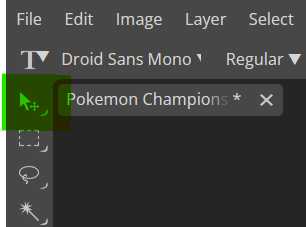
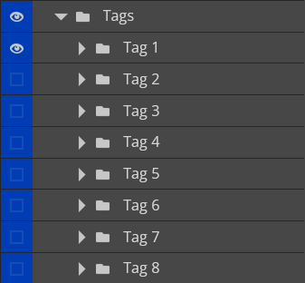
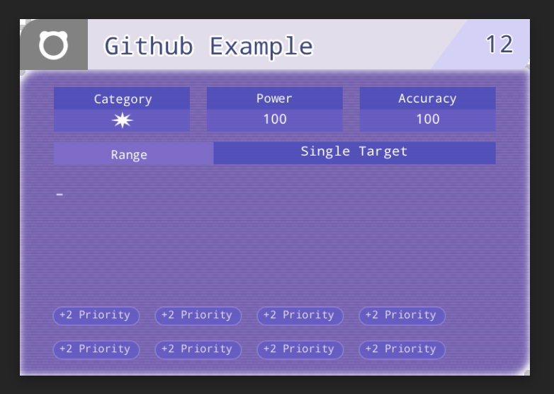
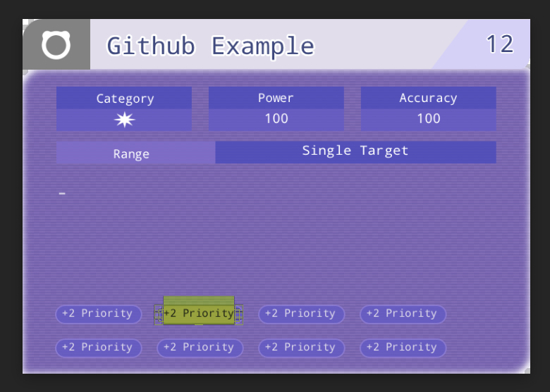
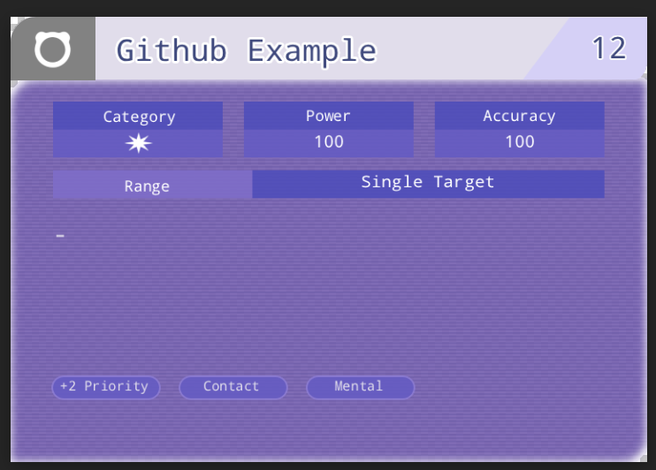
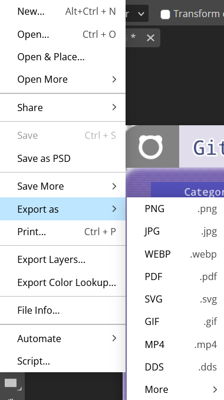

# How To
Thank you for checking out my Pokemon Champions move template! I am hoping this quick how-to should make it pretty easy to use.

## Step 1: Download
Download the .psd file in this repository to your local downloads folder

## Step 2: Open a Photoshop-like editor
I am sure Photoshop itself works great for this if you have it, but I don't and so I ended up using [Photopea](https://www.photopea.com/) to build and utilize the template since it is web-based and free.

## Step 3: Open file
On Photopea's page, use 'Open from Computer' to select the .psd file you downloaded. 

Once you have down so, it should look like this:

## Step 4: Fields
On the right, there are two folders: *Base Image* and *Edit Me*. 

Base image shouldn't need to be edited, and is just the base template. Edit Me has three subfolders, each color-coded to help as you expand them. 

## Step 5: Text Fields
With all of the 'text' fields, you can double click the field until it is highlighted to edit what it says.

If you don't like what it says you can press the `escape` key to undo the text edits, and if you want to save your changes you made you can select the 'Move Tool' on the left to exit the text field and edit the next one in the same way. 

## Step 6: Selection Fields

The next two fields have you deciding if the move is Special/Physical/Status and what type it is. To start, the template has the move be a Special Normal move. To change either of these, simply expad that folder and click the eye icon on special to remove it

and then select the exmpty box on whichever you want to change it to. 

It operates the exact same way to change the move's type.

## Step 7: Tags

This is a bit of a combination of the previous two steps. To start, you would want to select how many tags your move has (such as if it has non-stndard priority, if it is contact, or if it has a defined usage method). By default there is one tag selected, but I have space for up to 8. 

Just like with the text fields, you double click the tag to edit

and then click the 'Move Tool' to save your work. 

## Step 8: Saving
From here, to save your work as a PNG you can just go to File -> Export As -> PNG. 

You are now all set to share your move idea using a Pokemon Champions format!

# Room for improvement
I am happy with what I have so far, but I do know that the colors are a little off and the font is VERY off. If you know a way to make these better, or have ways to make this process a tad smoother, feel free to reach out!

My Github, Reddit, and Discord are all @SeasideStorm.